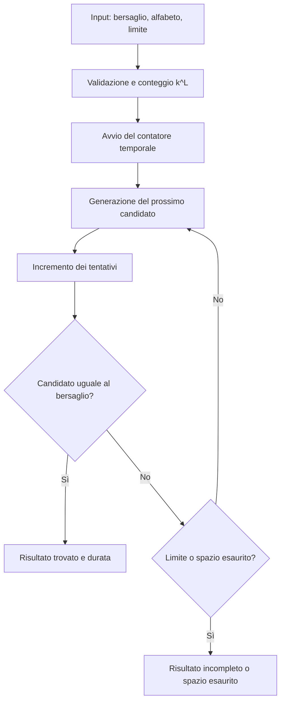

# Analisi tecnica della versione 2

## Requisito

Dato un bersaglio locale non vuoto, un alfabeto ordinato di simboli unici e una lunghezza nota, generare ciascuna combinazione una volta sola. Confrontare ogni candidato con il bersaglio; fermarsi al successo oppure al limite di tentativi. Restituire risultato, numero di tentativi, dimensione dello spazio e durata completa.

Il programma genera il bersaglio con `--length`, oppure usa quello esplicito di `--password`. Questa è una dimostrazione di un algoritmo di ricerca: l'applicazione conosce il bersaglio, ma il ciclo lo raggiunge mediante enumerazione, senza sfruttarne la posizione per saltare tentativi.

## Flusso

## Funzioni

| Funzione | Responsabilità |
| --- | --- |
| `validate_alphabet` | Richiede una stringa non vuota, senza caratteri ripetuti |
| `validate_length` | Richiede un intero tra 1 e 12, escludendo i booleani |
| `generate_password` | Crea un bersaglio casuale valido usando `secrets.choice` |
| `iter_candidates` | Fornisce un iteratore delle combinazioni nell'ordine dell'alfabeto |
| `brute_force_search` | Esegue la ricerca, applica il limite e misura l'intervallo |
| `build_parser` | Definisce opzioni e aiuto del terminale |
| `main` | Collega input, ricerca, gestione degli errori e presentazione |

### Generazione esaustiva

`product(alphabet, repeat=length)` rappresenta il prodotto cartesiano dell'alfabeto ripetuto per ciascuna posizione. Per `alphabet = 'as'` e `length = 2` produce tuple corrispondenti a `aa`, `as`, `sa`, `ss`. `join` costruisce la stringa corrente. L'iteratore restituisce una stringa alla volta e non conserva la lista completa.

L'ordine è quello dei simboli forniti, non un ordinamento alfabetico automatico. Con `alphabet = 'sa'` l'ordine diventa `ss`, `sa`, `as`, `aa`. I simboli duplicati sono rifiutati: altrimenti si avrebbero candidati ripetuti e il conteggio non descriverebbe stringhe distinte.

### Ricerca e limite

`islice(..., max_attempts)` impedisce di consumare un candidato oltre il limite. Il contatore parte da zero e viene incrementato prima di ogni confronto. Se il candidato coincide con il bersaglio, la funzione restituisce subito `SearchResult`. Un successo esattamente al limite è comunque un successo.

Se il limite è inferiore alla posizione del bersaglio, il risultato ha `password = None`, `found = False` e stato `limit_reached`. Il limite non dimostra che il bersaglio non esista nello spazio. Le nuove esecuzioni partono dall'inizio.

Per il contratto corrente il bersaglio deve essere composto da simboli dell'alfabeto. Un carattere esterno viene rifiutato prima di cercare: non si spreca una enumerazione che sappiamo già impossibile. Di conseguenza, visitando tutto lo spazio con il generatore previsto, il bersaglio viene trovato. Lo stato `exhausted` del risultato copre in generale uno spazio completamente visitato senza successo.

## Dati del risultato

`SearchResult` è una dataclass immutabile:

| Campo/proprietà | Significato |
| --- | --- |
| `password` | Candidato trovato, oppure `None` |
| `attempts` | Confronti effettivamente eseguiti |
| `total_combinations` | `k ** L`, prima della ricerca |
| `elapsed_ns` | Differenza completa dei due contatori in nanosecondi |
| `found` | Vero se `password` non è `None` |
| `status` | `found`, `limit_reached` o `exhausted` |
| `elapsed_seconds` | `elapsed_ns / 1_000_000_000` |
| `elapsed_milliseconds` | `elapsed_ns / 1_000_000` |
| `attempts_per_second` | Tentativi divisi per durata in secondi |
| `estimated_full_seconds` | `(durata_s / tentativi) * total_combinations` |

Se la durata o i tentativi sono nulli, velocità ed estrapolazione sono `None`: non si divide per zero e non si inventa una velocità infinita.

## Misura corretta e limiti dell'estrapolazione

`perf_counter_ns` è un contatore per intervalli; la differenza conserva anche i secondi interi. Il valore è espresso in nanosecondi, ma ciò non implica una precisione fisica di un nanosecondo sull'hardware usato.

Il cronometro parte prima della creazione e del consumo dell'iteratore. Comprende la preparazione dell'enumerazione, i candidati, il ciclo, il contatore e i confronti fino all'arresto. Esclude l'input, la generazione del bersaglio, le validazioni preliminari, il conteggio `k ** L`, la costruzione del risultato e la stampa.

L'iteratore pubblico valida nuovamente lunghezza e alfabeto: questo piccolo costo di preparazione è dentro la misura. Su ricerche molto brevi gli overhead influenzano fortemente la velocità media. I confronti tra stringhe possono inoltre avere costi diversi in base al prefisso condiviso. L'estrapolazione è quindi indicativa, non un tempo certificato o un benchmark di sistemi reali.

Esempio controllato: tre tentativi in 1,25 secondi su quattro combinazioni danno velocità di 2,4 tentativi/s e una estrapolazione lineare di circa 1,667 secondi sull'intero spazio. La durata osservata resta 1,25 secondi, cioè 1.250 millisecondi.

## Costi

Siano `k` i simboli e `L` la lunghezza. Lo spazio contiene `N = k ** L` stringhe. Con un limite `M` si visitano al massimo `min(N, M)` candidati; il successo può arrivare prima.

La costruzione e il confronto di una stringa richiedono nel caso generale lavoro proporzionale a `L`. Il costo peggiore della ricerca è quindi `O(min(N, M) * L)`, più validazione e preparazione. Non si memorizzano `N` stringhe: l'alfabeto, i pool/indici dell'iteratore e il candidato corrente richiedono memoria ausiliaria nell'ordine di `O(k + L)`, oltre ai dati di input e risultato.

Un alfabeto più grande o una password più lunga possono rendere la ricerca enorme anche se la memoria è piccola. Il default è un milione di tentativi e la lunghezza massima dell'esercizio è 12. Il limite si modifica esplicitamente con `--max-attempts`.

## Input e codici di uscita

| Esito | Codice CLI |
| --- | ---: |
| Bersaglio trovato | 0 |
| Limite raggiunto senza successo | 1 |
| Input/opzioni non validi o EOF | 2 |
| Interruzione Ctrl+C | 130 |

`--length` e `--password` sono alternativi. Le funzioni di libreria sollevano `TypeError` o `ValueError` per input errati; la CLI li presenta senza traceback. La nozione di carattere usata è quella degli elementi di una stringa Python (code point Unicode), senza normalizzazione di grafemi.

## Migrazione dalla v1

| Prima | Adesso |
| --- | --- |
| `generapassword(leng)` | `generate_password(length, alphabet)` |
| `get_random_string(length, dicti)` | `generate_password(length, alphabet)` con alfabeto stringa valido |
| `creapassword()` | Input gestito in `main` e opzione `--length` |
| `creaCampione(...)` | Eliminato; `iter_candidates` fornisce una enumerazione lazy |
| `decriptapassword(...)` | Sostituito da `brute_force_search`, che restituisce dati strutturati |
| `random.seed(...)` | Eliminato; nessuna inizializzazione globale casuale |
| `test.py` con pytest inutilizzato | Avvio di unittest, senza dipendenze esterne |

Sono cambiamenti intenzionali dell'API nella versione maggiore 2. I sorgenti ricevuti sono in `originali/`; il primo commit locale conserva anche la revisione annotata precedente. L'analisi della v1 è archiviata in [storia/ANALISI_V1.md](storia/ANALISI_V1.md).

## Riferimenti

[Prodotto cartesiano in Python](https://docs.python.org/3.12/library/itertools.html#itertools.product), [contatore di prestazioni](https://docs.python.org/3.12/library/time.html#time.perf_counter_ns), [generazione casuale](https://docs.python.org/3.12/library/secrets.html).
