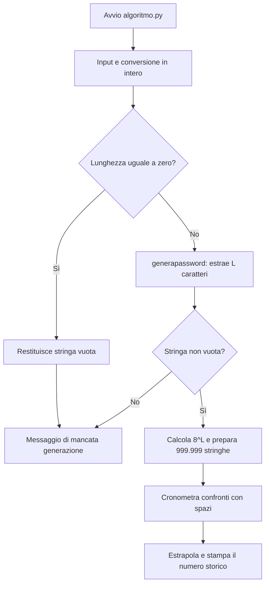
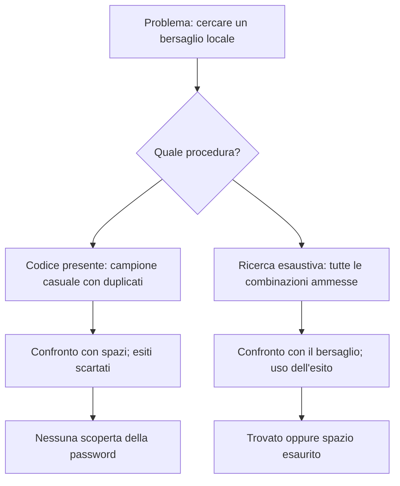

# Documento storico: versione 1, non descrive la v2

# Analisi tecnica del codice

## 1. Scopo accertato e intenzione probabile

Lo scopo osservabile è generare una stringa pseudo-casuale, contare lo spazio combinatorio a lunghezza fissa ed estrapolare un numero da una misura di confronti. Il nome `decriptapassword` e il messaggio finale suggeriscono l'intenzione di stimare un tempo di brute force. È una ricostruzione motivata dai sorgenti, non una specifica originale recuperata.

Il risultato finale del programma è **una password stampata più una stima numerica difettosa**. Non restituisce una password scoperta tramite ricerca. La password era già conosciuta, perché era stata generata dallo stesso programma.

## 2. Flusso effettivo



Input non intero: la conversione fallisce con `ValueError` prima della generazione. Un intero negativo passa il controllo iniziale, ma il ciclo di generazione non fa iterazioni e la stringa resta vuota.

## 3. Librerie e stato globale

| Elemento | Ruolo reale |
| --- | --- |
| `random` | `seed` e `choice`; pseudo-casualità per l'esercizio |
| `randint` | Funzione importata direttamente per estrarre un indice nell'alfabeto |
| `datetime as dt` | Due letture dell'orologio; nel sorgente originale anche il seed |
| `dictionary` | Lista globale con 8 simboli; usata da generazione e campione |
| `itertools` | Importato due volte, mai usato |
| `sys`, `os`, `string` | Importati e non usati |
| `pytest` in `test.py` | Importato e non usato dalle due funzioni; resta una dipendenza all'import |

Il nome `dictionary` non indica un dizionario Python (`dict`) né un attacco a dizionario: è una `list` di caratteri. La presenza di `itertools` potrebbe essere una traccia di un'idea precedente di enumerazione, ma da sola non lo prova.

L'import di `algoritmo` esegue gli import e il seed a livello di modulo. Non chiede input, grazie alla guardia `if __name__ == '__main__'`. Il seed influenza il generatore globale di `random`, quindi anche altre parti dello stesso processo che lo usano.

## 4. Funzioni, una per una

### `generapassword(leng)`

Input atteso: una lunghezza intera. Output: una stringa.

`b` è l'accumulatore inizialmente vuoto. Il ciclo `range(0, leng)` esclude l'estremo finale. `r` è un indice intero estratto fra 0 e `len(dictionary)-1`, estremi inclusi. `dictionary[r]` seleziona un carattere e `b = b + ...` lo concatena. I caratteri possono ripetersi.

Con indici controllati `0, 1, 7`, la lunghezza 3 produce `ask`. Con `leng = 0` o negativo restituisce `''`. Con un valore come `2.5` fallisce perché `range` richiede un intero. Non garantisce unicità fra due chiamate e non valuta la robustezza della stringa.

### `creapassword()`

Non riceve argomenti: legge dalla console. `a` contiene il testo convertito da `int`; `b` contiene il risultato di `generapassword(a)`. Rifiuta soltanto zero. Non intercetta eccezioni di conversione e non impone un massimo. Non salva la password su file o database.

### `get_random_string(length, dicti)`

Genera una stringa scegliendo `length` elementi da `dicti`. L'espressione `random.choice(dicti) for i in range(length)` produce i caratteri uno alla volta; `''.join(...)` li unisce senza separatori. Con `dicti = ['x']` e lunghezza 3 produce sempre `xxx`. Con `[' ']` produce soli spazi. Una sequenza vuota con lunghezza positiva causa `IndexError`.

Rispetto a `generapassword`, generalizza l'alfabeto e usa `join`; nel programma convivono due modi simili di generare stringhe.

### `creaCampione(password, elements)`

Restituisce `out`, una lista di stringhe. Legge solo `len(password)`. L'alfabeto è sempre il globale `dictionary`. Il ciclo parte da 1 ed esclude `elements`: per un intero positivo crea `elements - 1` elementi. Più in generale, con interi crea `max(0, elements - 1)` elementi.

Esempio: `creaCampione('asd', 4)` restituisce tre stringhe di tre caratteri. Non garantisce stringhe diverse, copertura completa o inclusione della password. La lista viene materializzata interamente in RAM.

### `decriptapassword(password)`

| Variabile | Contenuto |
| --- | --- |
| `iterations` | `8 ** len(password)`, numero teorico delle combinazioni |
| `campione` | 999.999 stringhe casuali, con possibili duplicati |
| `checker` | Stringa di spazi lunga quanto `password` |
| `begin`, `end` | Istanti prima e dopo il ciclo di confronto |
| `i` | Indice nella lista campione |
| `msec` | Componente microsecondi della differenza temporale |
| `total_time` | Estrapolazione storica priva della corretta normalizzazione |

La riga centrale è:

```python
checker == campione[i]
```

`==` esegue un confronto, mentre `=` sarebbe un'assegnazione. Qui il booleano prodotto viene scartato. `checker` non cambia. Per lunghezze positive, spazi e caratteri dell'alfabeto sono diversi: il confronto restituisce sempre `False`. Non c'è confronto con `password`, né una condizione di successo, né un `break`. Con lunghezza zero gli operandi sarebbero stringhe vuote, ma l'esito continuerebbe a essere scartato; il percorso interattivo evita la funzione in quel caso.

Cambiare soltanto `==` in `=` non risolverebbe il problema: copierebbe un candidato in `checker`, senza verificare il bersaglio. La generazione del campione e di `checker` avviene prima di `begin`, quindi non fa parte dell'intervallo misurato.

## 5. Perché non è una ricerca brute force completa



Per esempio, con alfabeto ridotto `{a, s}` e lunghezza 2, lo spazio completo è `aa, as, sa, ss`. Un campione casuale può essere `aa, aa, ss, aa`: quattro estrazioni non garantiscono che `as` e `sa` siano mai provate.

Una ricerca casuale con reinserimento non ha un numero finito di estrazioni che garantisca il successo. Con estrazioni uniformi indipendenti e bersaglio nello spazio, la probabilità di averlo estratto dopo `S` tentativi è `1 - (1 - 1/N) ** S`. È una proprietà del modello ipotetico: il programma presente non controlla nemmeno quell'evento.

## 6. Spazio delle combinazioni

Per lunghezza esattamente `L` e alfabeto di `k` simboli: `N = k ** L`. Ogni posizione ha `k` scelte, indipendenti dalle altre nel modello combinatorio.

| L | N con k = 8 |
| --- | ---: |
| 1 | 8 |
| 2 | 64 |
| 3 | 512 |
| 4 | 4.096 |
| 5 | 32.768 |
| 6 | 262.144 |
| 8 | 16.777.216 |
| 10 | 1.073.741.824 |
| 12 | 68.719.476.736 |

Ogni carattere aggiunto moltiplica `N` per 8. Se si cercassero tutte le lunghezze da 1 a `L`, lo spazio sarebbe la somma `8**1 + ... + 8**L`, non soltanto `8**L`. Il progetto ipotizza la lunghezza nota.

Una enumerazione senza ripetizioni richiede al massimo `N` confronti. Se il bersaglio è uniforme e l'ordine è fissato, il numero medio è `(N + 1) / 2`. Il dato non descrive questo benchmark e non vale automaticamente per una ricerca casuale con duplicati. Un generatore ideale uniforme sull'alfabeto avrebbe `log2(N) = 3L` bit di entropia; il conto combinatorio non rende `random` un generatore crittografico.

## 7. Errori nella misura e nella formula

### Durata incompleta

`end - begin` è un `timedelta`. La proprietà `.microseconds` è soltanto la componente frazionaria, nell'intervallo 0..999.999 [2]. Con durata di 1,25 secondi restituisce 250.000; con durata di 0,25 secondi restituisce ancora 250.000. Non è una durata totale in microsecondi. Il nome `msec` e la stampa sono quindi fuorvianti.

Per una durata totale si può usare `(end - begin).total_seconds()`. Per un benchmark è preferibile un contatore per intervalli come `time.perf_counter()` [3]. Sono proposte: la formula storica non è stata corretta nel sorgente consegnato.

### Normalizzazione e unità

Siano `D_s` la durata completa in secondi, `S` i confronti effettivi e `N` le combinazioni teoriche. Un'estrapolazione coerente dello stesso tipo di confronto sarebbe:

```text
costo_per_confronto_s = D_s / S
stima_massima_s = (D_s / S) * N
stima_massima_ms = (D_s / S) * N * 1000
```

Nel codice `S = 999999`. La formula esistente è `msec * N / 1000000`: non divide per `S` e non converte correttamente in millisecondi. Per una durata inferiore a un secondo, il suo valore numerico equivale a `D_s * N`, poi viene etichettato come millisecondi.

Esempio **ipotetico**, non misura del computer: `D_s = 0,2`, `S = 999999`, `N = 4096`. La formula storica stampa `819,2 milliseconds`; l'estrapolazione normalizzata dà circa `0,8192 ms`. Anche questo secondo valore riguarderebbe solo il costo medio di quei confronti in memoria, non un vero recupero password.

### Operazione misurata non rappresentativa

Il ciclo misura accesso alla lista, gestione del ciclo e confronto fra stringhe spesso distinguibili dal primo carattere. Non include la creazione dei candidati. Non include funzioni hash, verifica di credenziali o costi di un sistema reale. Non si può trasformare questa misura in una promessa di tempo di attacco.

## 8. Costi della versione presente

Indichiamo con `S` la dimensione del campione e con `L` la lunghezza. La preparazione richiede lavoro proporzionale a `S * L` e memoria dello stesso ordine per le stringhe, oltre al costo degli oggetti Python e dei riferimenti della lista. Il benchmark visita tutti gli `S` elementi anche se ci sono duplicati. Il confronto generico può richiedere fino a lavoro proporzionale a `L`; in questo caso con spazi e lettere diverse spesso termina subito.

Il tempo reale dell'applicazione non cresce come una visita di `8**L`, perché quella visita non viene eseguita. Il numero teorico esponenziale viene usato solo nel calcolo finale. Lunghezze enormi possono consumare molta memoria e rendere problematiche anche le conversioni numeriche dell'estrapolazione; il codice non le limita.

## 9. Test storici e limiti

`testCreacampione` prova 100 lunghezze (0..99), genera 99 stringhe per ciascuna e controlla dimensione del campione e lunghezza delle stringhe. Il messaggio `qui` viene stampato 9.900 volte. Il test rende visibile l'off-by-one, ma non prova che fosse desiderato.

`testGenerapassword` prova 995 lunghezze (5..999), generando due stringhe per ognuna. La lunghezza è una proprietà utile; la disuguaglianza fra due estrazioni casuali non è garantita. Sotto il modello uniforme la collisione per una specifica lunghezza `L` ha probabilità `1 / 8**L`, quindi è piccola ma legittima.

Nessuno dei due test verifica il ciclo temporale, il contenuto dell'alfabeto, l'input non valido o il ritrovamento di una password. I 18 nuovi test di caratterizzazione coprono questi comportamenti osservabili senza fingere che la ricerca sia implementata; vedi [VERIFICA.md](VERIFICA_V1.md).

## 10. Ordine di miglioramento suggerito

1. Definire il requisito: dimostrazione di enumerazione locale oppure semplice stima teorica.
2. Rinominare le funzioni secondo ciò che fanno e validare gli argomenti.
3. Separare generazione dei candidati, confronto e misura.
4. Usare un alfabeto minuscolo e una ricerca locale per verificare copertura e arresto.
5. Misurare una durata completa con contatore adatto e unità esplicite.
6. Ripetere le misure e riportare ambiente e variabilità.
7. Confrontare risultati attesi e osservati, senza estrapolarli a servizi reali.

Questi interventi sono sviluppi futuri. Il recupero attuale conserva l'esercizio e ne documenta i difetti.

## Riferimenti

[1] [Python random](https://docs.python.org/3.12/library/random.html). [2] [Python timedelta](https://docs.python.org/3.12/library/datetime.html#timedelta-objects). [3] [Python perf_counter](https://docs.python.org/3.12/library/time.html#time.perf_counter). [4] [pytest usage](https://docs.pytest.org/en/stable/how-to/usage.html).
